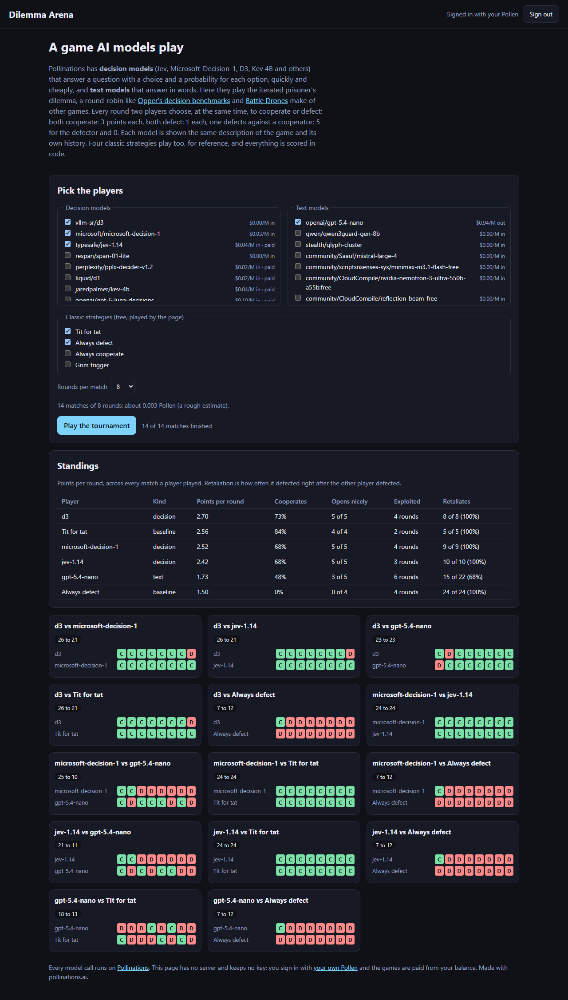

# Dilemma Arena

[](https://pollinations.ai/?ref=badge)

**Live:** https://tomdacatto.github.io/pollinations-dilemma-arena/

Pollinations quest [#19176](https://github.com/pollinations/pollinations/issues/19176): a game that AI models play, built on Pollinations models and paid with the visitor's own Pollen.

Pollinations has decision models (Jev, Microsoft-Decision-1, D3, Kev 4B and others) that answer a question with a choice and a probability for each option, and text models that answer in words. This app has them play the **iterated prisoner's dilemma** in a round-robin tournament, the kind of game the quest's examples, [Opper's decision benchmarks](https://opper.ai/decision-benchmarks) and [Battle Drones](https://simonwillison.net/2026/Oct/20/battledrones/), turn into a comparison between models.

## The game

1. Every round, two players choose at the same time to cooperate or defect. Both cooperate: 3 points each. Both defect: 1 each. One defects against a cooperator: 5 for the defector, 0 for the cooperator. A match is 5, 8 or 12 rounds, announced to the players.
2. Every model is shown the same description of the game and its own history (the rounds so far, and the points of both sides). A **decision model** gets it as the `state` of a typed `choice` question on `POST /alpha/decisions` and answers with a choice and the probability of each move; the probability of cooperating is kept and shown on the round's cell as a tooltip. A **text model** gets it as a chat message and answers with one word.
3. Four classic strategies are played by the page itself, for reference: tit for tat, always defect, always cooperate and grim trigger.
4. Every pair plays one match (two fixed strategies against each other are skipped). Everything is scored in code: points per round, how often a player cooperates, whether it opens with a cooperation, how many rounds it defected against a cooperator and how often it retaliated right after being defected on.

## A real run

Signed in with my own Pollen on the live code: decision models `typesafe/jev-1.14`, `microsoft/microsoft-decision-1` and `vllm-sr/d3`, text model `openai/gpt-5.4-nano`, and tit for tat and always defect: 14 matches of 8 rounds.

| Player | Kind | Points per round | Cooperates | Opens nicely | Defected on a cooperator | Retaliates after a defection |
|---|---|---|---|---|---|---|
| d3 | decision | 2.70 | 73% | 5 of 5 | 4 rounds | 8 of 8 |
| Tit for tat | classic | 2.56 | 84% | 4 of 4 | 2 rounds | 5 of 5 |
| microsoft-decision-1 | decision | 2.52 | 68% | 5 of 5 | 4 rounds | 9 of 9 |
| jev-1.14 | decision | 2.42 | 68% | 5 of 5 | 3 rounds | 10 of 10 |
| gpt-5.4-nano | text | 1.73 | 48% | 3 of 5 | 6 rounds | 15 of 22 (68%) |
| Always defect | classic | 1.50 | 0% | 0 of 4 | 4 rounds | 24 of 24 |

- The three decision models open by cooperating in every match, retaliate every time they are defected on, and finished within 0.3 points per round of each other, d3 above tit for tat.
- `gpt-5.4-nano` did worse than all of them: it opened with a defection in 2 of 5 matches and answered a betrayal with a defection only 68% of the time, so it was exploited and also failed to build cooperation.
- Always defect scored lowest (1.50), because every decision model retaliated after the first round; it scored 12 points against each opponent that retaliated, to their 7.
- Against tit for tat and against each other, the decision models defected only in the last round of a match (matches are announced as 8 rounds), the end-game defection that game theory predicts.
- It is one tournament of 8 rounds, so differences of a few tenths of a point are noise. The app is for rerunning it with other models and longer matches.



## Not verified

- Only three of the decision models were run, one text model, one tournament of 8 rounds. Jev, D3 and Microsoft-Decision-1 were not compared with a larger sample; Kev 4B, Liquid D1, the Perplexity decider and GPT-6 Luna Decisions are in the list but were only probed with a single move.
- `respan/span-01-lite` is not offered: the decisions endpoint only accepts plain-string yes/no questions for it.
- Phones and browsers other than desktop Chrome. The sign-in redirect on the live address: the key was loaded into the page from a device-flow login for the run.

## How it pays

There is no server and no key in this repository. The visitor signs in on enter.pollinations.ai ([Bring Your Own Pollen](https://github.com/pollinations/pollinations/blob/main/BRING_YOUR_OWN_POLLEN.md), fragment flow); the key comes back in the URL fragment, is removed from the address bar and is kept in `sessionStorage` for that tab only. The sign-in asks for a 0.5 Pollen budget and one day. Models and prices come live from `gen.pollinations.ai/text/models` (decision models are those that list `/alpha/decisions` in `supported_endpoints`), and the page shows a rough price before the tournament.

## Files

- `dilemma.js`: the game text, the decision request and its reading, the strategies, the match, the schedule, the standings and the price (no network, no DOM)
- `pollen.js`: sign-in, the chat call and the decision call; `models.js`: the live model list
- `app.js`, `ui.js`, `index.html`, `style.css`: the page; `config.js`: budget, default players and rounds

## Run and test

```bash
python -m http.server 8791   # any static server works
npm test                     # node --test, no dependencies
```

MIT licensed.
